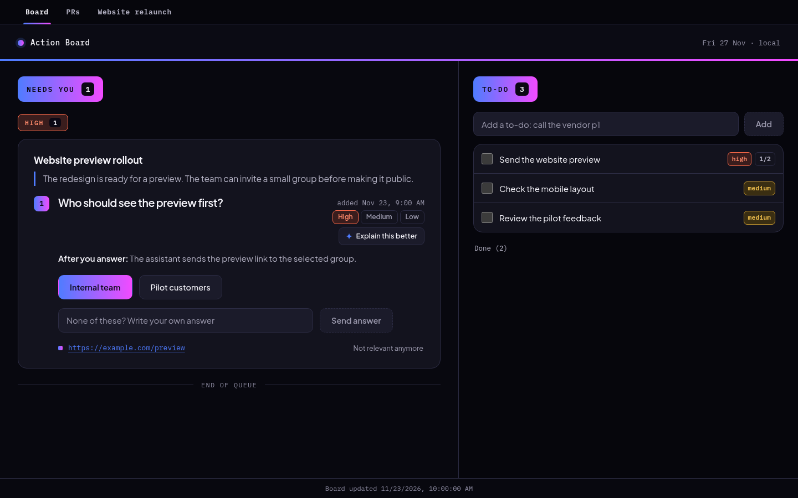
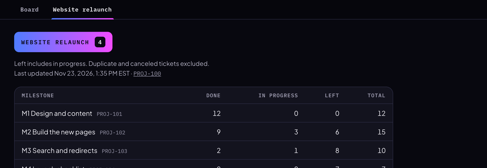
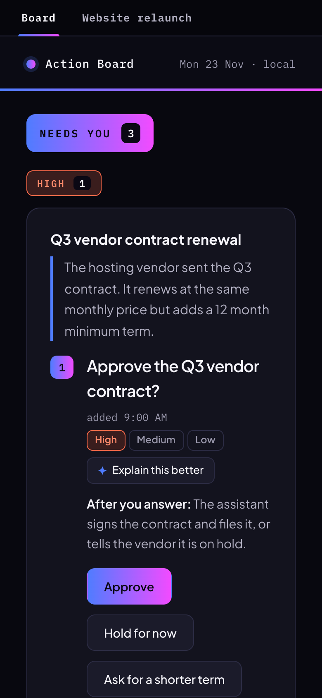

# Action Board

A small local web page that shows one person every decision that needs them, plus a few "at a glance" lists and a
project progress tab. A chief of staff bot (CoS bot) owns the board: it raises decisions with a command line helper,
the person answers on the page or in chat, and the answers flow back to the bot through a webhook.

This README is written for a chief of staff bot that has to set the board up, A to Z, for its own user, with no
other context. Every command, payload and exit code below comes from the code in this repository. The short
checklist at the end ([Setup checklist for a chief of staff bot](#setup-checklist-for-a-chief-of-staff-bot)) is the
order to do things in.

## Screenshots

The screenshots use bundled example data.

The Board tab on a desktop: open decisions grouped by priority.



The project tab: milestone progress with a summed total line.



The Board tab on a phone (390px wide).



## Contents

- [Screenshots](#screenshots)
- [What it is](#what-it-is)
- [Requirements and install](#requirements-and-install)
- [Configuration](#configuration)
- [Keeping it running](#keeping-it-running)
- [Desktop app](#desktop-app)
- [Architecture](#architecture)
- [The CLI contract: bin/ab.mjs](#the-cli-contract-binabmjs)
- [How a CoS bot raises a decision and builds its chat card](#how-a-cos-bot-raises-a-decision-and-builds-its-chat-card)
- [The webhook: in-app actions back to the bot](#the-webhook-in-app-actions-back-to-the-bot)
- [The sync model](#the-sync-model)
- [Adapting it](#adapting-it)
- [Testing](#testing)
- [Security notes](#security-notes)
- [Setup checklist for a chief of staff bot](#setup-checklist-for-a-chief-of-staff-bot)

## What it is

The page has two tabs at the top: **Board** (the default) and the **project tab**, whose label is the project title
stored in its data file (the example is "Website relaunch"). The selected tab is kept in the URL: `#project` opens the
project tab, no hash means the Board. Arrow keys, Home and End move between tabs.

### The Board tab

- **Header.** "Action Board", today's date, and a delivery marker when something is wrong:
  "Webhook not set up (app/.env.local)" when there is no webhook URL and an answer or note is waiting, or
  "N answers not delivered" when answers failed to reach the webhook.
- **Needs you.** Every open decision (a decision with no `answer`), as cards. Cards are grouped into **High**,
  **Medium** and **Low** sections (a section only shows when it has cards). Inside a section the oldest card
  (`created_at`) comes first. Cards are numbered 1, 2, 3 across the sections. A card with no priority counts as
  Medium. When nothing is open the page says "Nothing needs you right now."
- **A decision card**, top to bottom:
  - the **title** in bold, then the **context** (1 to 3 plain sentences: what this is and what happened);
  - the **question**, with a time stamp at the top right: "added 9:14 AM" for a new card, "updated Nov 12, 2:40 PM"
    after a re-raise, in the configured time zone;
  - the **priority control**: three segments, High, Medium, Low. The active one is the card's priority. One tap on
    another segment moves the card at once (the queue re-sorts) and saves it to the board file. If the save fails,
    the old level comes back with "Could not save priority. Try again.";
  - **"Explain this better"**: asks the assistant to reword the card (a `decision.clarify` webhook). The card shows
    "Rewording..." until the card changes on the board (a re-raise with new text), is answered, or goes away. If the
    request fails it shows "Could not send (HTTP 500). Try again." (the receiver's status) or "Could not send. Try
    again." (no answer at all, or no webhook URL);
  - optional **details**: bullets and labeled lists under the question;
  - **"After you answer:"** followed by `what_happens_after`;
  - the **options**. Single select: one click answers. Multi select: options toggle and a Submit button confirms;
  - a **free text answer** field ("None of these? Write your own answer", Enter or "Send answer") unless the card
    sets `allowCustom: false`;
  - at the bottom left the **reference** (`card_ref`): a bare URL becomes a link, other text is shown as is with any
    URLs inside linked. At the bottom right **"Not relevant anymore"**: it tells the assistant (a
    `decision.not_relevant` webhook) and, once that is delivered, removes the card from the board file
    (`ab clear <id> --reason "not relevant"`). It shows "Clearing..." until the card is gone.
- **Answering on the page.** The card disappears right away, a toast says "Answered: Approve", the answer is kept
  in the browser (localStorage) and sent to the webhook as `decision.answered`. The answer becomes permanent when the
  CoS bot records it with `ab answer`. Until then the browser hides the card on its own.
- **To-do** (beside the queue on wide screens, under it on narrow ones). Today includes overdue tasks. Upcoming
  groups future due dates and undated work. Done shows recent completions. Change priority, add comments or subtasks,
  and complete or reopen items in place. Quick add understands dates, times and priority, for example
  `call the vendor Friday 3pm p1`. Due dates and times use America/New_York.
- **Footer**: "Board updated" and the board file's `updated_at`.
- **Live updates.** The page follows the board file. Any change made with `bin/ab.mjs` (or by hand) shows on every
  open tab within about a second, with no reload, and typed text is kept.

### The PRs tab

The top grid has **Hotfixes**, **Non-project PRs**, **Project PRs** and **Tickets with no PR yet**. **Review requests**
and **Other repos** span the width below. A matching GitHub feed entry adds CI status, review blockers, each
reviewer's state, labels, and open human review threads. Expand a PR to read its reviewers and thread comments.
Click the flame to toggle HOT. Within each section, HOT items come first, then the oldest PRs by GitHub creation
time. Entries without a creation time keep their file order at the end of their HOT group.

The tab starts with the lists written by `ab glance`. The server joins GitHub details by PR URL. Review requests
come from the author and signed-in viewer. Other repos are GitHub repos outside `ACTION_BOARD_PR_REPOS` when that
setting is populated. Hotfixes target a main, master, release or hotfix branch, or come from a hotfix branch.
Project PRs target the `project` branch, with a `project/` head or a title like `Project FE-12: Preview banner` as
a fallback for entries without a base branch.

Each entry links to its source and has a **Message &lt;assistant&gt;** button. Enter sends a note as `item.message`.
Shift+Enter or Cmd/Ctrl+Enter adds a line. The composer closes after delivery.

### The project tab

A table with one line per milestone: the milestone key and title (linked to its ticket, with the ticket id), then
**Done**, **In progress**, **Left** and **Total**, and a bold **All milestones** line summed from the milestones.
Above it: "Left includes in progress. Duplicate and canceled tickets excluded.", "Last updated" with the stored
time, and a link to the parent ticket or project. It updates within a second when `ab project-refresh` rewrites the
file.

### Tab shortcuts

Cmd+1 opens Board, Cmd+2 opens PRs, and Cmd+3 opens the project tab. The shortcuts pause while a text field has
focus. Arrow keys, Home and End select tabs when the tab bar has focus. The PRs and project tabs can be opened
directly with `#prs` and `#project`.

## Requirements and install

- macOS or Linux.
- Node.js 22.18 or newer, with npm (check with `node -v`).
- A current browser. Chrome, Edge and Firefox resolve any `*.localhost` name to this machine, so the default address
  `http://board.localhost:8085` needs no setup. `http://localhost:8085` and `http://127.0.0.1:8085` always work too.
- Optional, for the browser end to end checks only: Google Chrome.

Install and start:

```bash
git clone <URL of this repository> action-board
cd action-board
./start.sh
```

`start.sh` checks the Node version, creates `app/.env.local` from `app/.env.example` the first time (it never
overwrites it), runs `npm ci` in `app/` the first time, then starts the server on `127.0.0.1` and opens the board in
a browser. `./start.sh --no-open` does the same without opening a browser (use that for a background service).

The board starts with an example board (3 decisions, a few glance items) and an example project. Replace them with
the user's real data through `bin/ab.mjs` (see [The CLI contract](#the-cli-contract-binabmjs)).

## Configuration

Board settings live in `app/.env.local` (created by `start.sh`, ignored by git). A variable set in the shell
environment wins over the file. **Restart the board after any change** (see
[Keeping it running](#keeping-it-running)), then reload the page.

| Variable | Default | What it does |
| --- | --- | --- |
| `ACTION_BOARD_WEBHOOK_URL` | empty | Where the page POSTs in-app answers, notes, "Explain this better" and "Not relevant anymore". Empty: answers and notes wait in the browser. |
| `ACTION_BOARD_WEBHOOK_AUTH` | empty | Sent as the `Authorization` header on every webhook POST, exactly as written, for example `Bearer <token>`. |
| `ACTION_BOARD_ASSISTANT_NAME` | `your assistant` | The assistant's name in the UI: "Message Ada", "Sent to Ada". |
| `ACTION_BOARD_TIMEZONE` | `America/New_York` | IANA time zone for card times, the header date and the project tab's "Last updated". |
| `ACTION_BOARD_HOST` | `board.localhost` | The host name the board answers on, besides `localhost` and `127.0.0.1` (always allowed). Also used in the chat card footer. |
| `ACTION_BOARD_PORT` | `8085` | The port. `bin/ab.mjs` reads it too, to find the live board. |
| `ACTION_BOARD_PR_REPOS` | empty | Comma-separated GitHub owner/repo names, for example `acme/example-api,acme/example-web`. An empty list disables GitHub requests. |
| `ACTION_BOARD_GITHUB_LOGIN` | empty | Optional viewer login when the feed has yet to return a viewer. |
| `ACTION_BOARD_FEED` | enabled when repos are set | Set to `off` to disable GitHub requests while keeping the repo grouping. |
| `GITHUB_TOKEN` | GitHub CLI login | Set in the server's environment to authenticate the GraphQL requests. If unset, the feed reads the CLI credential with `gh auth token`. Sign in first with `gh auth login`. The token stays on the server. |

Example `app/.env.local`:

```bash
ACTION_BOARD_WEBHOOK_URL=<the webhook URL of your answers routine>
ACTION_BOARD_WEBHOOK_AUTH=Bearer <the routine's secret>
ACTION_BOARD_ASSISTANT_NAME=Ada
ACTION_BOARD_TIMEZONE=America/Los_Angeles
ACTION_BOARD_HOST=board.localhost
ACTION_BOARD_PORT=8085
ACTION_BOARD_PR_REPOS=acme/example-api,acme/example-web
```

### Optional host mapping

Only needed if the user wants a name that does not end in `.localhost`, or uses a browser or tool that does not
resolve `*.localhost`. `./add-host.sh` adds `127.0.0.1 <ACTION_BOARD_HOST>` to `/etc/hosts` (it asks for the
password once, through sudo) and flushes the DNS cache on macOS. `./remove-host.sh` removes exactly that line. Both
read `ACTION_BOARD_HOST` from the shell or `app/.env.local`, default `board.localhost`.

## Keeping it running

### In a terminal

```bash
./start.sh            # start (Ctrl+C stops it)
./start.sh --no-open  # start without opening a browser
```

To restart, stop it with Ctrl+C and run `./start.sh` again.

### macOS: launchd

Save this as `~/Library/LaunchAgents/com.example.action-board.plist`. Replace `/ABSOLUTE/PATH/TO/action-board` with
the clone's absolute path, and `/ABSOLUTE/PATH/TO/NODE/BIN` with the directory that holds `node` and `npx` (run
`dirname "$(command -v node)"`).

```xml
<?xml version="1.0" encoding="UTF-8"?>
<!DOCTYPE plist PUBLIC "-//Apple//DTD PLIST 1.0//EN" "http://www.apple.com/DTDs/PropertyList-1.0.dtd">
<plist version="1.0">
<dict>
  <key>Label</key>
  <string>com.example.action-board</string>
  <key>ProgramArguments</key>
  <array>
    <string>/bin/bash</string>
    <string>/ABSOLUTE/PATH/TO/action-board/start.sh</string>
    <string>--no-open</string>
  </array>
  <key>WorkingDirectory</key>
  <string>/ABSOLUTE/PATH/TO/action-board</string>
  <key>EnvironmentVariables</key>
  <dict>
    <key>PATH</key>
    <string>/ABSOLUTE/PATH/TO/NODE/BIN:/usr/bin:/bin</string>
  </dict>
  <key>RunAtLoad</key>
  <true/>
  <key>KeepAlive</key>
  <true/>
  <key>StandardOutPath</key>
  <string>/ABSOLUTE/PATH/TO/action-board/runs/server.log</string>
  <key>StandardErrorPath</key>
  <string>/ABSOLUTE/PATH/TO/action-board/runs/server.log</string>
</dict>
</plist>
```

```bash
mkdir -p /ABSOLUTE/PATH/TO/action-board/runs
launchctl bootstrap gui/$(id -u) ~/Library/LaunchAgents/com.example.action-board.plist   # start now and at every login
launchctl kickstart -k gui/$(id -u)/com.example.action-board                                # restart
launchctl bootout gui/$(id -u)/com.example.action-board                                     # stop (until the next bootstrap)
tail -f /ABSOLUTE/PATH/TO/action-board/runs/server.log                                      # server log
```

### Linux: systemd user unit

Save this as `~/.config/systemd/user/action-board.service`, with the same two placeholders:

```ini
[Unit]
Description=Action Board

[Service]
WorkingDirectory=/ABSOLUTE/PATH/TO/action-board
ExecStart=/ABSOLUTE/PATH/TO/action-board/start.sh --no-open
Environment=PATH=/ABSOLUTE/PATH/TO/NODE/BIN:/usr/bin:/bin
Restart=on-failure

[Install]
WantedBy=default.target
```

```bash
systemctl --user daemon-reload
systemctl --user enable --now action-board   # start now and at every login
systemctl --user restart action-board        # restart
systemctl --user stop action-board           # stop
journalctl --user -u action-board -f         # server log
loginctl enable-linger "$USER"               # optional: keep it running while the user is logged out
```

### Is it up?

```bash
curl -s -o /dev/null -w '%{http_code}\n' http://127.0.0.1:8085/__ab/board   # 200 when the board is served
```

`node bin/ab.mjs check` also reports "live board not reachable" when the server is down.

## Desktop app

Install Electron in `desktop/` with `npm ci`, then run `npm start` from that directory. The app opens the local board,
shows the open decision count on the Dock, and sends a notification for each new decision after the first sync.
Cmd/Ctrl+Shift+A toggles the window. The **Go** menu shares the board's tab shortcuts.

On macOS the packaged app registers a login item and starts hidden at login. Run `npm run package` in `desktop/`
to build and ad-hoc sign the Apple Silicon app under `desktop/dist/`. The app uses the existing server when it is
running, then tries the launchd job and the local Vite install. Set `ACTION_BOARD_HOME` if the packaged app should
find the checkout somewhere other than `~/action-board`. Set `ACTION_BOARD_URL` to override the default loopback
URL. The app uses `ACTION_BOARD_PORT` or the port in `app/.env.local` when present.

The icon is built from `desktop/icon/action-board-icon.svg`. To regenerate the checked-in icon files offline, run
`npm run icon` in `desktop/` with FFmpeg and its librsvg decoder installed.

## Architecture

- **No database.** The data is two source files:
  - `app/src/data/board.ts`: the decisions and the glance lists, as JSON between `/* BOARD-JSON-START */` and
    `/* BOARD-JSON-END */`.
  - `app/src/data/project.ts`: the project tab, as JSON between `/* PROJECT-JSON-START */` and `/* PROJECT-JSON-END */`.
  `bin/ab.mjs` is the only supported writer. It validates input, takes a lock, stamps times, and replaces the file
  via an atomic replace (temp file, fsync, rename).
- **One server.** The Vite dev server (`npx vite` in `app/`, started by `start.sh`) serves the React page and the
  board's own routes. It binds to `127.0.0.1` only.
- **Live feed.** The server watches `board.ts` (a directory watch plus a 500 ms stat poll, 100 ms debounce), keeps
  the last version that parses (a half written or broken file never reaches the page), and pushes every change to
  open pages as Server-Sent Events. The page falls back to polling `/__ab/board` every 2 seconds while the stream is
  down, and refetches when the window gets focus. `project.ts` reaches the page through Vite's hot reload instead.
- **In the browser.** App answers and notes are kept in localStorage (`action-board:app-answers`,
  `action-board:messages`) until delivered and, for answers, until the board file records them.

### The board's routes

Every route below checks the `Host` header: it must be `localhost`, `127.0.0.1`, `[::1]` or `ACTION_BOARD_HOST`
(any port), else **403**. When the request has an `Origin` header, its host must be one of the same names, else
**403**. POST routes also require `Content-Type: application/json` (else **415**) and answer **405** to other
methods.

| Method and path | Purpose | Replies |
| --- | --- | --- |
| `GET` / `HEAD /__ab/board` | The current board as JSON. | 200; 503 before the first good parse. |
| `GET` / `HEAD /__ab/todos` | The current to-do list as JSON. | 200; 503 before the first good parse. |
| `GET` / `HEAD /__ab/feed` | The last GitHub PR feed snapshot, with status and quota. | 200. |
| `GET` / `HEAD /__ab/events` | Server-Sent Events for `board`, `todos`, and `feed`; a ping every 15 s. | 200 stream; 503 before the first good board parse. |
| `POST /__ab/feed/refresh` | Requests a feed refresh subject to debounce, quota and backoff. | 200 with the start status. |
| `POST /__ab/todo` | Runs a to-do mutation through `ab`. | 200; 400 invalid input; 404 unknown id. |
| `POST /__ab/hot` | Body `{"url":"<PR URL>","hot":true}`. Saves a HOT mark through `ab`. | 200; 400 invalid input. |
| `GET /__ab/hot-log` | HOT changes, optionally filtered by an ISO `since` timestamp. | 200; 400 invalid input. |
| `POST /__ab/webhook` | Fallback forwarder. Forwards the body unchanged to `ACTION_BOARD_WEBHOOK_URL` with `ACTION_BOARD_WEBHOOK_AUTH` as `Authorization` (both read from `.env.local` on each request). Accepts only the events `decision.answered`, `item.message`, `decision.clarify`, `decision.not_relevant`. Body up to 64 KB. 15 s timeout. | 200 `{"status":<receiver HTTP status>}`; 400 `{"status":null}` bad JSON or event; 503 no webhook URL; 502 receiver unreachable. Never echoes the URL or auth. |
| `POST /__ab/delivery-log` | The page reports each webhook attempt; one sanitized JSON line is appended to `app/.delivery-log.jsonl`. Body up to 8 KB. | 204; 400 bad report; 500 write failed. |
| `POST /__ab/priority` | Body `{"id":"<decision id>","priority":"high"}`. Runs `ab priority <id> <level>`. Body up to 1 KB. | 200 `{"ok":true,"priority":"high"}`; 400 bad input; 404 unknown id; 409 already answered; 502 anything else. |
| `POST /__ab/clear` | Body `{"id":"<decision id>"}`. Runs `ab clear <id> --reason "not relevant"`. The page calls it only after the `decision.not_relevant` webhook got a 2xx. Body up to 1 KB. | 200 `{"ok":true}`; 400 bad input; 404 unknown id; 502 anything else. |

Everything else (`/`, the page's scripts) is the normal Vite dev server, limited to the same host names.

### Files and logs

| File | What it holds |
| --- | --- |
| `app/src/data/board.ts` | The board (decisions and glance). |
| `app/src/data/project.ts` | The project tab. |
| `app/.ab-log.jsonl` | One line per `ab` write: `{"at","op","id",...}`. |
| `app/.ab-cleared.jsonl` | Tombstones: `{"id","reason","at","card"}` per clear, `{"id","restored":true,"at"}` per restore. |
| `app/.delivery-log.jsonl` | One line per webhook POST attempt from the page (never the URL, auth, question, context or note text). |
| `app/src/data/board.ts.lock`, `project.ts.lock` | Short lived lock directories while `ab` writes. |
| Server output | The terminal, `runs/server.log` (launchd example) or `journalctl` (systemd). |

All of these except the two data files are ignored by git.

## The CLI contract: bin/ab.mjs

`bin/ab.mjs` is the only supported way to change the board. Run it with Node from anywhere; it finds the board from
its own location. The examples run from the repository root.

- Success output is JSON on stdout. Errors are one or more lines starting with `ab: ` on stderr.
- Writes are serialized by a lock. Every write also refreshes the board's own `updated_at`.
- A command that refuses changes nothing.

### Exit codes

| Code | Meaning |
| --- | --- |
| 0 | Done (also `answer` on a decision that was already answered: a safe retry). |
| 1 | `check` or `lint` found problems (the JSON on stdout lists them). |
| 2 | Bad input: a missing or invalid field, input that is not JSON, a wrong command, or a corrupt data file. |
| 3 | `raise` only: written to `board.ts`, but the live server does not serve it within 4 seconds. The server is down. Do not send the chat card. |
| 4 | Refused: the decision is already answered, was cleared before (raise), is already on the board (restore), or was cleared without a saved card (restore). |
| 5 | Unknown decision id, nothing to restore, or the lock was held for over 10 seconds. |

### Environment

| Variable | Default | Use |
| --- | --- | --- |
| `AB_FILE` | `app/src/data/board.ts` next to `bin/` | The board file. The logs live two directories up from it. |
| `AB_PROJECT_FILE` | `project.ts` next to `AB_FILE` | The project file. |
| `AB_TODOS_FILE` | `todos.ts` next to `AB_FILE` | The Board's to-do data file. |
| `AB_EVENTS_FILE` | `data/events.jsonl` next to `bin/` | Append-only HOT change log. |
| `ACTION_BOARD_PORT`, `ACTION_BOARD_HOST` | shell, then `app/.env.local`, then `8085` and `board.localhost` | Where to find the live board, and the card footer. |
| `AB_URL` | `http://127.0.0.1:<port>` | The live board's base URL, if it differs. |
| `AB_MAX_HIGH` | `10` | How many open high cards `open` and `check` allow before flagging a flood. A positive integer; anything else exits 2. |
| `AB_NO_SERVER` | unset | `1` skips the live server checks (tests only). |

### raise

Adds a decision, or updates an open one with the same id in place. Input is a JSON object, as the first argument
or on stdin (`node bin/ab.mjs raise < decision.json`).

```sh
node bin/ab.mjs raise '{"id":"vendor-contract-q3","title":"Q3 vendor contract renewal","card_ref":"https://example.com/contracts/q3-hosting","context":"The hosting vendor sent the Q3 contract. It renews at the same monthly price but adds a 12 month minimum term.","question":"Approve the Q3 vendor contract?","what_happens_after":"The assistant signs the contract and files it.","options":[{"id":"approve","label":"Approve"},{"id":"hold","label":"Hold for now"}],"blocking":false}'
```

A card is blocking only when a named piece of in-flight work (a specific open PR, merge or task being actively
driven) cannot move until the user answers. Rules or process questions, optional proofs, and cards older than a day
or two are not blocking.

Fields (anything else, including `answer` and `updated_at`, is refused with exit 2):

| Field | Required | Type and rules |
| --- | --- | --- |
| `id` | yes | Lowercase kebab case, 3 to 81 characters: `^[a-z0-9][a-z0-9-]{2,80}$`. Stable: the same id updates the same card. |
| `title` | yes | A short topic shown bold at the top. One line, 60 characters or fewer, at least two plain words besides ids (like `ABC-123`, `#12`, URLs) and the words pr, ticket, issue. "ABC-1234" fails; "Q3 vendor contract renewal" passes. Stored trimmed. |
| `context` | yes | What the item is and what happened, in plain words. 1 to 3 sentences, 600 characters or fewer, at least 6 plain words besides ids. Shown first on the card. |
| `question` | yes | Must name the thing. Refused: "the/this/that/these/those" followed by ticket, tickets, pr, prs, pull request, issue, card, bug, fix, change, branch, item or one, at the end, before punctuation, or before is/are/was/were/be/been/should/will/would/can/could/go/get/stay/need/needs/has/have/do/does; the word "it" anywhere; "this" or "that" at the end or before punctuation. "What should happen to the ticket?" and "Send it back to the vendor?" fail; "Approve the Q3 vendor contract?" passes. |
| `what_happens_after` | yes | Non-empty text: what the assistant does after the answer. Shown as "After you answer:". |
| `options` | yes | Non-empty array of `{"id","label"}`. Ids unique and non-empty, labels non-empty. `custom` is reserved. |
| `blocking` | yes | `true` for a blocking card (definition above), otherwise `false`. Missing or not a boolean: exit 2, `ab: blocking is required: true only if a named open PR, merge or task cannot move until this is answered, and then blocks names it; else false`. `true` stores `priority` `high` (anything blocking something is the highest priority, so it shows first): with no `priority` or `high` it is stored high, with `medium` or `low` it is refused with exit 2 (`ab: blocking cards are always high priority: ...`). A re-raise with `true` upgrades the card to high, never down; with `false` the `priority` rules below apply as before. Cards raised before this field have none (unknown) and are never an error. |
| `blocks` | with `blocking: true` | The in-flight work the card holds up, like `"PR #43 hired application guard merge"`. 1 to 200 characters after trimming, stored trimmed, shown on the card as "Blocks: ...". Required with `blocking: true` (missing, blank, not a string or longer: exit 2, `ab: blocking:true needs "blocks" (1 to 200 chars) naming the work it blocks: a card is blocking only when ...`); refused with `blocking: false` (exit 2, `ab: blocks is only for blocking:true cards: ...`). A re-raise with `blocking: false` drops a stored `blocks`. |
| `details` | no | Non-empty array. Each entry is a non-blank string (a bullet) or `{"label":"...","items":["...",...],"ordered":true or false}` (a labeled list, `ordered` optional). |
| `multiSelect` | no | `true` or `false` (default `false`). `true`: several options can be picked. |
| `allowCustom` | no | `true` or `false` (default `true`). `false` hides the free text answer and refuses `ab answer --custom`. |
| `priority` | no | `high`, `medium` or `low`. Left out: a new card has none (counts as medium) and a re-raise keeps the stored one. A blocking card is always `high` (see `blocking`). |
| `card_ref` | no | A string or `null`. A reference shown at the bottom of the card; a bare URL becomes a link. |
| `link` | no | A stored evidence URL for the Board and chat card. Fills an absent `card_ref`. |
| `created_at` | no | ISO time. Used only for a new card (or an old card that has none); default now. |

The link guard checks GitHub and Linear references on every raise. GitHub links use
`https://github.com/<owner>/<repo>/pull/<number>` and Linear links use
`https://linear.app/<workspace>/issue/<key>`. When `card_ref` is a bare PR number, a named repo and number, or a
ticket key, a supplied `link` must match it. A bare reference can stand alone. An invalid or mismatched reference
exits 2 before changing the board.

Refusals with exit 4: the id was cleared before ("use a new id only for a genuinely new decision"), or the id is
already answered.

Stamps: a new card gets `created_at` and `updated_at` equal to it ("added ..." on the card). A re-raise keeps the
card's slot and `created_at` and sets `updated_at` to now ("updated ..." on the card).

Output (exit 0), printed only after the live server serves the new card:

```json
{
  "ok": true,
  "board": "live",
  "card": {
    "title": "Q3 vendor contract renewal",
    "context": "The hosting vendor sent the Q3 contract. It renews at the same monthly price but adds a 12 month minimum term.",
    "question": "Approve the Q3 vendor contract?",
    "what_happens_after": "The assistant signs the contract and files it.",
    "options": ["Approve", "Hold for now"],
    "multiSelect": false,
    "allowCustom": true,
    "link": "https://example.com/contracts/q3-hosting",
    "decision_id": "vendor-contract-q3",
    "priority": "medium",
    "blocking": false,
    "blocks": null,
    "footer": "Also on your Action Board: http://board.localhost:8085 (vendor-contract-q3)"
  }
}
```

When the card has `details`, the card also has `"details"` (after `question`) as plain text lines: `- item` for a
bullet, `Label:` then `- item` or `1. item` for a labeled list. `options` are the labels in input order. `link` is the
stored `card_ref` (or `null`). `priority` is the effective priority (`medium` when none is stored); `blocking` is the raised value and
`blocks` the stored one (`null` when there is none).

### answer

Records the user's answer. `--by chat` when the user answered in chat, `--by app` when it came from the page's
webhook. `--at` is the answer time (default now; for app answers pass the payload's `answered_at`).

```sh
node bin/ab.mjs answer vendor-contract-q3 approve --by chat
```

Several options on a multi select decision (stored in option order, whatever order they are given in):

```sh
node bin/ab.mjs answer offsite-venue-quotes lakeside,farm --by app --at 2026-11-10T09:05:00.000Z
```

A free text answer (trimmed; refused with exit 2 when the card has `allowCustom: false`):

```sh
node bin/ab.mjs answer vendor-contract-q3 --custom "Approve if the term drops to 6 months" --by chat
```

Output: `{"ok":true,"status":"answered","live":true,"answer":{...}}`. The stored `answer` is one of:

- single: `{"answer":"approve","answer_label":"Approve","answered_by":"chat","answered_at":"..."}`
- multi: `{"answer":["lakeside","farm"],"answer_label":["Lakeside lodge","Farm retreat"],"answered_by":"app","answered_at":"..."}`
- custom: `{"answer":"custom","answer_label":"<text>","answered_by":"chat","answered_at":"...","custom_text":"<text>"}`

Answering an already answered decision changes nothing and prints
`{"ok":true,"status":"already-answered","answer":{...}}` with exit 0, so retries are safe. Errors: exit 2 for an
unknown option, several options on a single select card, a blank custom text, or missing `--by`; exit 5 for an
unknown id. `live` is `false` when the server did not show the answer within 4 seconds (the file is still written).
An answered decision leaves "Needs you" and can never be raised again.

### clear

Removes a decision (open or answered) and tombstones its id, so `raise` refuses it later. `--reason` is required.

```sh
node bin/ab.mjs clear vendor-contract-q3 --reason "Signed in the vendor portal"
```

Output: `{"ok":true,"status":"cleared","id":"vendor-contract-q3"}`. Exit 5 for an unknown id. The tombstone line in
`app/.ab-cleared.jsonl` keeps the removed card, so `restore` can bring it back.

### restore

Puts the card saved by the latest clear back at the end of the decisions, open again (its answer dropped, its
priority and stamps kept), and lets `raise` use the id again.

```sh
node bin/ab.mjs restore vendor-contract-q3
```

Output: `{"ok":true,"status":"restored","id":"vendor-contract-q3"}`. Exit 5 when nothing was cleared (or it was
already restored); exit 4 when the id is already on the board or was cleared without a saved card.

### priority

Sets only that open card's priority. Its `updated_at` stays, so the card does not show as updated.

```sh
node bin/ab.mjs priority vendor-contract-q3 high
```

Output: `{"ok":true,"id":"vendor-contract-q3","priority":"high","was":"medium","live":true}`. Exit 2 for a bad
level, or for `medium` or `low` on an open card stored with `"blocking":true` (`ab: <id> is a blocking card; blocking
cards stay high`), 4 if the decision is answered, 5 for an unknown id. The page's priority control runs this same command.

### glance

Replaces all three PR tab lists at once. Input is a JSON object on stdin.

```sh
node bin/ab.mjs glance < glance.json
```

```json
{
  "waiting": [
    { "title": "Signed NDA from the design agency", "who": "Waiting on the agency", "link": "https://example.com/docs/nda" }
  ],
  "tickets": [
    { "id": "PROJ-118", "title": "Add a cookie banner to the new site", "status": "To Do", "link": "https://example.com/tickets/PROJ-118" }
  ],
  "others": [
    { "title": "Update the pricing page copy (#42)", "author": "Sam", "who": "Your review requested", "link": "https://github.com/acme/example/pull/42" }
  ]
}
```

- `waiting` (required array): `{"title","who","link"?}`. `who` says who or what it waits on.
- `tickets` (required array): `{"id","title","status","link"?}`.
- `others` (optional, missing means `[]`): `{"title","author","who","link"}`, all non-blank strings, with `link`
  starting with `http://` or `https://`.
- The PR items in `waiting` and `others` can also carry branch names `base` and `head`, and a boolean `hot`.
  An explicit HOT toggle overrides a mark supplied by a glance update.
- A `parked` key is retired: an empty list is accepted and dropped, a non-empty one is refused (raise those as
  decisions).

Output: `{"ok":true,"live":true,"counts":{"waiting":1,"tickets":1,"others":1}}`.

### hot and unhot

Toggle the mark on a GitHub PR URL. Add `--by assistant` to record who changed it. An unchanged mark is a no-op.
A changed mark is saved on the board and appended to the HOT event log.

```sh
node bin/ab.mjs hot https://github.com/acme/example-api/pull/11764
```

```sh
node bin/ab.mjs unhot https://github.com/acme/example-api/pull/11764
```

### open and check

`open` reports the board. `check` reports the same and exits 1 if there is any problem. Pass `--chat` with the ids
of the decisions that have an open card in chat, so `check` can compare chat and board.

```sh
node bin/ab.mjs open
```

```sh
node bin/ab.mjs check --chat vendor-contract-q3,offsite-venue-quotes
```

```json
{
  "ok": true,
  "open_on_board": ["vendor-contract-q3", "launch-post-day"],
  "served_open": ["vendor-contract-q3", "launch-post-day"],
  "counts": { "waiting": 2, "tickets": 2, "others": 2 },
  "priority_open": { "high": 1, "medium": 1, "low": 0 },
  "open_priority": [
    { "id": "vendor-contract-q3", "priority": "high", "blocking": true, "blocks": "Signing the Q3 hosting contract before the vendor deadline" },
    { "id": "launch-post-day", "priority": "medium", "blocking": false, "blocks": null }
  ],
  "problems": []
}
```

`open_on_board` is the open ids in the file, `served_open` what the live server serves (`null` when it is down).
`open_priority` lists each open card's priority (`medium` when none is stored), `blocking` (`null` for a card
raised before the field existed) and `blocks` (`null` when there is none).
Problems reported: the live board not reachable, the served board older than the file, an open card with
`"blocking":true` whose priority is not `high` (a hand edit: `blocking is true but priority is <level>; blocking cards
must be high (fix with ab priority <id> high)`), an open card with `"blocking":true` and no non-blank `blocks`
(`blocking is true but blocks is empty: name the in-flight work it holds up, or raise <id> again with blocking:false`),
more than `AB_MAX_HIGH` (default 10) open high cards (`12 open cards are high (limit 10): a flood of high cards hides
the real blockers`; a high card without `blocking` still counts), and with `--chat`:

- `chat card <id> is NOT on the board: run ab raise for it`
- `chat card <id> is answered on the board: clear the chat card`
- `board decision <id> has no open chat card: card it from ab raise output, or ab clear it`

A corrupt board file is reported as a problem too (`"ok":false`, exit 1).

### lint

Lists open decisions that break the title, context or question rules (cards raised before the rules existed, or
hand edits), or that have `"blocking":true` without priority `high` or without a non-blank `blocks`. A card without
`blocking` is never flagged for it. It does not count high cards; `check` does. Exit 1 if any.

```sh
node bin/ab.mjs lint
```

Output: `{"ok":false,"failing":[{"id":"...","problems":["context is required: ..."]}]}`. Fix a card by raising it
again with the same id.

### backfill-stamps and backfill-titles

One-shot repair tools for boards written before stamps and titles existed. A new install does not need them.

```sh
node bin/ab.mjs backfill-stamps
```

Fills missing `created_at` and `updated_at` from `app/.ab-log.jsonl` (`--dry-run` reports without writing). Output:
`{"ok","dry_run","wrote","stamped","blank","no_history","unchanged","counts"}`.

```sh
node bin/ab.mjs backfill-titles < titles.json
```

Input `{"<decision id>":"<title>"}` sets the title on open cards that have none (same title rules; one invalid title
writes nothing, exit 2). Output: `{"ok","wrote","set","unknown","skipped_answered","skipped_has_title","still_missing"}`.

### project-refresh

Rewrites the project tab. Input is a JSON object, as the first argument or on stdin (`-` or no argument).

```sh
node bin/ab.mjs project-refresh '{"updated_at":"2026-11-23T18:35:00.000Z","milestones":[{"id":"PROJ-101","done":12,"in_progress":0,"left":0,"total":12},{"id":"PROJ-102","done":9,"in_progress":3,"left":6,"total":15},{"id":"PROJ-103","done":2,"in_progress":1,"left":8,"total":10},{"id":"PROJ-104","done":0,"in_progress":0,"left":7,"total":7}]}'
```

| Field | Required | Rules |
| --- | --- | --- |
| `title` | no | The tab label and heading, non-blank, 60 characters or fewer. Kept when left out. |
| `parent` | no | `{"id","url"}`, non-blank, `url` http(s). The link next to "Last updated". Kept when left out. |
| `updated_at` | no | ISO 8601 time with a zone (`Z` or `+hh:mm`). Stored in UTC. Default now. |
| `milestones` | yes | Non-empty array, shown in this order. Each: `id` (unique, no spaces, up to 80 characters), `done`, `in_progress`, `left`, `total` (non-negative integers), and optional `key` (like `M1`), `title`, `url` (http(s)). |

Rules, each refused with exit 2 and the file unchanged: `done + left == total`, `in_progress <= left` (left includes
in progress). For an id already in the file, a missing `key`, `title` or `url` is kept from the file. A new id needs
all three. Output: `{"ok":true,"milestones":4,"totals":{"done":23,"in_progress":4,"left":21,"total":44},"updated_at":"..."}`.

The data file shape (`app/src/data/project.ts`):

```json
{
  "title": "Website relaunch",
  "updated_at": "2026-11-23T18:35:00.000Z",
  "parent": { "id": "PROJ-100", "url": "https://example.com/tickets/PROJ-100" },
  "milestones": [
    { "key": "M1", "id": "PROJ-101", "title": "Design and content", "url": "https://example.com/tickets/PROJ-101",
      "done": 12, "in_progress": 0, "left": 0, "total": 12 }
  ]
}
```

To start the user's real project, send `title`, `parent` and every milestone with its `key`, `title` and `url` once;
later refreshes only need the ids and counts.

### To-do commands

The mutation commands take a JSON object as an argument or on stdin. `todo-add` takes a name or quick-add text.
Explicit fields win over parsed quick-add fields. Priority defaults to medium and the id is generated when omitted.
Use a top-level item's id as `parent_id` to add a subtask. Due dates use Eastern wall time.

```sh
node bin/ab.mjs todo-add '{"id":"call-vendor","quick":"call the vendor Friday 3pm p1"}'
```

```sh
node bin/ab.mjs todo-update '{"id":"call-vendor","description":"Ask about the lease renewal","priority":"high","due":{"date":"2026-12-01","time":"09:30"}}'
```

```sh
node bin/ab.mjs todo-comment '{"id":"call-vendor","text":"Left a voicemail at 3:05"}' --author Assistant
```

```sh
node bin/ab.mjs todo-list --view today
```

```sh
node bin/ab.mjs todo-done '{"id":"call-vendor"}'
```

```sh
node bin/ab.mjs todo-reopen '{"id":"call-vendor"}'
```

Use `null` to clear an item's description, due date, or parent. Completing a parent leaves its subtasks open.
`todo-list` also supports `upcoming`, `done`, and `all` (the default). Invalid input exits 2 and unknown ids exit 5.

## How a CoS bot raises a decision and builds its chat card

1. Write the decision as JSON (see [raise](#raise)). Pick a stable, readable id such as `vendor-contract-q3`. Write
   the context for someone reading it cold. Set `blocking` to `true` only when a named piece of in-flight work
   (a specific open PR, merge or task being actively driven) cannot move until the user answers, and name that work
   in `blocks`; `ab` then stores it as high priority so the user sees it first. Rules or process questions, optional
   proofs, and cards older than a day or two are not blocking.
2. Run `node bin/ab.mjs raise '<json>'` (or pipe the JSON on stdin, which avoids shell quoting problems).
3. Act on the exit code:
   - **0**: parse stdout and build the chat message from `card` (below). Remember `decision_id` with the chat message.
   - **2**: read the `ab:` lines, fix the JSON, run it again.
   - **3**: the server is down. Do not send a chat card. Start the board (see
     [Keeping it running](#keeping-it-running)), then run the same raise again.
   - **4**: the id is answered or was cleared. Only use a new id if this is genuinely a new decision.
   - **5**: the board is locked by another writer for over 10 s; retry shortly.
4. Build the chat card from the printed `card`, never from your own copy of the JSON, so chat and board always match:

```text
*Q3 vendor contract renewal*                 <- card.title, bold
The hosting vendor sent the Q3 contract. ... <- card.context
Approve the Q3 vendor contract?              <- card.question
- ...                                        <- card.details, when present
After you answer: The assistant signs ...    <- card.what_happens_after
[Approve] [Hold for now]                     <- card.options, as buttons or a numbered list
Or reply in your own words.                  <- only when card.allowCustom is true
Priority: medium                             <- card.priority, optional
https://example.com/contracts/q3-hosting     <- card.link, when not null
Also on your Action Board: http://board.localhost:8085 (vendor-contract-q3)   <- card.footer
```

   `card.options` holds the labels in the order you gave them, so option `n` in chat is `options[n].id` from your
   raise JSON. When `card.multiSelect` is true, let the user pick several.
5. When the user answers in chat, run `node bin/ab.mjs answer <decision_id> <option id[,option id]> --by chat` (or
   `--custom "<their words>"`). Exit 0 with `already-answered` means it was answered on the page first: tell the user
   which answer counted.
6. **Re-raise the same id to update a card in place**: new wording, new facts, a new priority. The card keeps its
   place and `created_at`, shows "updated ...", and the priority stays unless you send one. Edit the chat message
   to match the new printed card.
7. When the decision stops mattering, `node bin/ab.mjs clear <id> --reason "<why>"` and close the chat card.

## The webhook: in-app actions back to the bot

### What the page sends

Every POST has `Content-Type: application/json` and, when `ACTION_BOARD_WEBHOOK_AUTH` is set, `Authorization: <that
value exactly>`. There are four events.

`decision.answered`: the user answered a card on the page.

```json
{
  "event": "decision.answered",
  "decision_id": "vendor-contract-q3",
  "card_ref": "https://example.com/contracts/q3-hosting",
  "question": "Approve the Q3 vendor contract?",
  "answer": "approve",
  "answer_label": "Approve",
  "answered_by": "app",
  "answered_at": "2026-11-23T15:04:05.000Z"
}
```

For a multi select card `answer` and `answer_label` are arrays in option order (`["lakeside","farm"]`,
`["Lakeside lodge","Farm retreat"]`). For a free text answer `answer` is `"custom"`, `answer_label` is the text and
there is one more field, `"custom_text"`, with the same text. `card_ref` is a string or `null`.

`decision.clarify`: the user pressed "Explain this better".

```json
{
  "event": "decision.clarify",
  "decision_id": "vendor-contract-q3",
  "question": "Approve the Q3 vendor contract?",
  "context": "The hosting vendor sent the Q3 contract. It renews at the same monthly price but adds a 12 month minimum term.",
  "clicked_at": "2026-11-23T15:04:05.000Z"
}
```

`decision.not_relevant`: the user pressed "Not relevant anymore".

```json
{
  "event": "decision.not_relevant",
  "decision_id": "vendor-contract-q3",
  "question": "Approve the Q3 vendor contract?",
  "cleared_at": "2026-11-23T15:04:05.000Z"
}
```

`item.message`: the user sent a note from a glance row.

```json
{
  "event": "item.message",
  "message_id": "00000000-0000-4000-8000-000000000001",
  "item_id": "https://example.com/docs/nda",
  "item_section": "waiting",
  "item_title": "Signed NDA from the design agency",
  "item_who": "Waiting on the agency",
  "item_link": "https://example.com/docs/nda",
  "text": "Chase them again tomorrow morning.",
  "sent_at": "2026-11-23T15:04:05.000Z"
}
```

- `item_section` is `waiting`, `others` or `tickets`.
- `item_id` is the ticket id for a ticket, otherwise the item's `link`, otherwise `<section>:<title as a slug>`
  (for example `waiting:q4-budget-numbers`).
- `item_who` (waiting and others items), `item_status` (tickets) and `item_link` are left out when the item has none.
- `message_id` is unique per note; use it to drop duplicates.

### How it is delivered

- **Direct first.** The page POSTs straight to `ACTION_BOARD_WEBHOOK_URL`. Because of the JSON body and the
  `Authorization` header the browser sends a CORS preflight first, so the receiver must allow the board's origin
  for the direct path to work.
- **Fallback.** If the direct POST throws (a CORS refusal or a network error), the page POSTs the same body to the
  board's own `/__ab/webhook`, and the server forwards it with the same URL and auth from `app/.env.local`. A
  receiver without CORS support therefore still works, through the fallback. A timeout (15 s) is not sent again
  through the fallback in the same try, since the receiver may have it already.
- **Success** is any 2xx from the receiver.
- **Retries.** One cycle is three tries, 0 ms, 500 ms and 1500 ms apart. Answers and notes are stored in the
  browser and tried again on page load, on window focus, when the tab becomes visible, and on every live board
  update, until delivered. "Explain this better" and "Not relevant anymore" are not stored: one cycle, then an error
  on the card, and the user can press again.
- **No webhook URL.** Answers and notes wait in the browser (the header says "Webhook not set up (app/.env.local)").
  "Explain this better" and "Not relevant anymore" fail with "Could not send. Try again." on the card.
- **Not relevant anymore** clears the card through `/__ab/clear` only after its webhook got a 2xx. So by the time the
  receiver handles `decision.not_relevant`, the board has removed (or is removing) the card itself.
- **Delivery log.** Each try appends one line to `app/.delivery-log.jsonl`:
  `{"event","decision_id","answer","answer_label","http","via","attempt","status","at"}` for answers,
  `{"event","message_id","item_id","item_section",...}` for notes, and `{"event","decision_id",...}` for clarify and
  not relevant. `via` is `direct` or `fallback`, `status` is `delivered`, `retrying` or `failed`, `http` is the
  receiver's status or `null`. The URL, auth, question, context and note text are never logged.

### Setting up the receiving side as a Grok Bot routine

1. In Grok Bot, create a routine with a **webhook trigger**. Name it something like "Action Board answers".
2. Copy the routine's webhook **URL** and the **auth header value** it expects (for example `Bearer <secret>`).
3. Put both in `app/.env.local` (never in a committed file, never in chat):

   ```bash
   ACTION_BOARD_WEBHOOK_URL=<the routine's webhook URL>
   ACTION_BOARD_WEBHOOK_AUTH=<the routine's auth header value>
   ```

4. Restart the board (see [Keeping it running](#keeping-it-running)) and reload the page.
5. Test the path end to end without the browser, through the fallback route:

   ```bash
   curl -s -X POST http://127.0.0.1:8085/__ab/webhook -H 'Content-Type: application/json' \
     -d '{"event":"item.message","message_id":"setup-test-1","item_id":"waiting:setup-test","item_section":"waiting","item_title":"Setup test","text":"Setup test from the board. Reply that you got it.","sent_at":"2026-11-23T15:00:00.000Z"}'
   ```

   `{"status":200}` (or another 2xx) means the routine received it. `{"status":null}` with HTTP 503 means the URL is
   not set; 502 means the routine could not be reached.
6. Then answer a card on the page and check `app/.delivery-log.jsonl` for `"status":"delivered"`.

Where the commands run: the board lives on the user's own computer, and Grok Bot routines run on the bot's side. The routine must run `bin/ab.mjs` on the computer that hosts the board, through the bot's access to that registered computer (a shell command with that machine selected). If the board instead runs on the bot's own computer, the routine runs the commands there directly and the user opens the board through that machine.

The routine prompt (fill in the repository path):

```text
You receive webhook events from the user's Action Board, a local board of decisions at
/ABSOLUTE/PATH/TO/action-board. You are the only writer of that board, and you change it only with
node /ABSOLUTE/PATH/TO/action-board/bin/ab.mjs. The request body is JSON with an "event" field.

1. "decision.answered": the user answered decision_id on the board page.
   Run: node bin/ab.mjs answer <decision_id> <answer> --by app --at <answered_at>
   - answer is a string: pass it as the option id.
   - answer is a list: pass the ids joined with commas, for example lakeside,farm.
   - answer is "custom": run node bin/ab.mjs answer <decision_id> --custom "<custom_text>" --by app --at <answered_at>
   Exit 0 with "already-answered" means it was answered in chat first: keep the stored answer, tell the user which
   answer counted. Then mark the matching chat card answered and do what the card's "what_happens_after" promised.
2. "decision.clarify": the user did not understand the card. Read the current card (node bin/ab.mjs open, then the
   decision in app/src/data/board.ts) and rewrite title, context, question and details in plainer words, with the
   missing facts. Re-raise the SAME id with node bin/ab.mjs raise '<json>' (same options unless they were the
   problem). The page shows "Rewording..." until the new text arrives. Update the chat card from the printed card.
3. "decision.not_relevant": the user says decision_id no longer matters. The board clears the card itself. Close the
   chat card and drop any follow-up you planned for it. If node bin/ab.mjs open still lists the id after a few
   seconds, run node bin/ab.mjs clear <decision_id> --reason "not relevant" (exit 5 means it is already gone).
4. "item.message": a note from the user about a glance item (item_section waiting, others or tickets; item_title,
   item_link). Treat text as an instruction from the user about that item: do it, or reply in chat with what you
   will do. Use message_id to ignore duplicates.
Never edit the board files by hand. Never print or store the webhook URL or auth value. Reply with a short summary of
what you did.
```

## The sync model

**The core rule: every path into and out of the board goes through `bin/ab.mjs`, and only the CoS bot runs it.**

- The CoS bot is the only writer. Other bots and people do not touch the board: they send their asks to the CoS bot,
  which decides whether to raise them.
- New decisions: the CoS bot raises them and sends the matching chat card built from the printed card.
- Answers in chat: the CoS bot runs `ab answer --by chat`.
- Answers and actions on the page: the webhook routine above handles them.
- An **hourly refresh routine** keeps the board true: it runs `ab check`, matches open pull requests and tickets to
  board items, sweeps health (stale cards, cards whose question resolved elsewhere get cleared with a reason),
  rewrites the glance lists, and chases owners of things the user is waiting on.
- A **project refresh routine** (triggered by the ticket tracker, for example a Linear webhook, or scheduled) keeps
  the project tab current with `ab project-refresh`.

Counting rules for the project tab, per milestone:

- Exclude tickets in a duplicate or canceled state, from every count.
- `done`: tickets in a completed state.
- `in_progress`: tickets started but not completed (in progress, in review).
- `left`: every ticket that is not done, **including** the ones in progress.
- `total`: `done + left`. `ab` refuses anything else, and refuses `in_progress > left`.

Sample prompt for the hourly refresh routine (schedule: every hour):

```text
You keep the user's Action Board at /ABSOLUTE/PATH/TO/action-board true. Change it only with
node bin/ab.mjs from that directory. You are the only writer.

1. Run node bin/ab.mjs check --chat <ids of decisions that have an open chat card>. Fix every problem it lists:
   - "not reachable": the board is down; restart it (launchctl kickstart -k gui/$(id -u)/com.example.action-board
     or systemctl --user restart action-board) and check again.
   - "chat card X is NOT on the board": raise X again from your notes, or close the chat card.
   - "chat card X is answered on the board": close the chat card.
   - "board decision X has no open chat card": send the chat card from a fresh raise of X, or clear X.
2. For each open decision, check the world: if the pull request merged, the ticket closed, the meeting happened, or
   the question was settled elsewhere, run node bin/ab.mjs clear <id> --reason "<what happened>" and tell the user
   in one line. If the facts changed, re-raise the same id with the new facts. A card open for more than 3 days
   gets a one-line nudge in chat, once.
3. Rebuild the glance from the source systems and run node bin/ab.mjs glance < glance.json:
   - waiting: things the user is waiting on from others (title, who, link);
   - others: other people's open pull requests that involve the user (title, author, who, link); say
     "Your review requested" in who when the user's review is requested;
   - tickets: the user's open tickets with no pull request (id, title, status, link).
4. For each waiting item older than 2 working days, send its owner a short, polite nudge, at most once a day.
5. Run node bin/ab.mjs lint and re-raise any failing card with plain words.
Report: decisions open by priority (from check), what you cleared and why, and who you chased.
```

Sample prompt for the project refresh routine (trigger: issue updates in the project, or every 30 minutes):

```text
You keep the project tab of the user's Action Board at /ABSOLUTE/PATH/TO/action-board current.
The project is <project name or URL>; its milestones are <list of milestone ids, or "the project's milestones">.

1. For each milestone, list its tickets. Drop tickets whose state is duplicate or canceled.
2. Count: done = completed; in_progress = started but not completed (in progress or in review);
   left = everything not done, including in progress; total = done + left.
3. Run node bin/ab.mjs project-refresh with {"milestones":[{"id","done","in_progress","left","total"},...]} in
   milestone order. Give "key", "title" and "url" only for a milestone the board has not seen before. Leave
   updated_at out (it defaults to now).
4. Exit 2 means a count is inconsistent: recount, never force numbers to fit.
Reply with the totals line from the output.
```

## Adapting it

| To change | Where |
| --- | --- |
| Assistant name, time zone, host, port | `app/.env.local` (see [Configuration](#configuration)). |
| Board title in the header and the browser tab | `app/src/App.tsx` (the `wordmark` heading) and `app/index.html` (`<title>`). |
| Tabs: rename, add, remove | `app/src/Tabs.tsx`: the `TABS` list, the `#hash` handling in `fromHash` and `select`, and one `tabpanel` per tab. A new tab is a component like `app/src/ProjectTab.tsx`. The project tab's label is the `title` in `app/src/data/project.ts`. |
| Glance sections (titles, fields, add one) | Panels in `app/src/PrsTab.tsx`; item types and `Board.glance` in `app/src/data/types.ts`; the shape check in `app/src/data/parse.ts`; the section names in `app/src/messages.ts` (`GlanceSection`, `glanceItemId`); the `glance` command and counts in `bin/ab.mjs`; the board shape test in `app/test/board-file.test.ts`. Sorting and grouping are in `app/src/prs.ts`. |
| Project data shape (columns, fields) | `Project` types in `app/src/data/types.ts`; the data in `app/src/data/project.ts`; columns and totals in `app/src/project.ts`; the table in `app/src/ProjectTab.tsx`; validation in `projectData` in `bin/ab.mjs`. |
| Decision card layout and wording | `app/src/DecisionCard.tsx`. |
| Priority levels and labels | `app/src/priority.ts` (page) and `PRIORITIES` in `bin/ab.mjs` (CLI). |
| Plain words rules for raise | `contextError`, `questionError`, `titleError` in `bin/ab.mjs`. |
| Theme (colors, fonts) | CSS variables in `:root` at the top of `app/src/styles.css` (`--bg`, `--surface`, `--text`, `--cobalt`, `--fuchsia`, `--grad`, the `--high-*`, `--medium-*`, `--low-*` priority colors). Fonts are bundled in `app/public/fonts/`. |
| Webhook events and retries | `app/src/delivery.ts` (payloads, `RETRY_DELAYS_MS`) and `WEBHOOK_EVENTS` in `app/vite.config.ts`. |
| Server routes and host checks | `app/vite.config.ts` and `app/server/live.ts`. |

After a change, run the tests below.

## Testing

```bash
cd app && npm ci && npx tsc --noEmit && npx vitest run   # type check and unit, component and server tests
cd .. && bash bin/ab.test.sh                             # the CLI, against temp copies of the data files
(cd desktop && npm ci && npm test)                       # the desktop badge, notifications and Go menu
```

What the vitest files cover (`app/test/`):

| File | Covers |
| --- | --- |
| `readme-commands.test.ts` | Runs every single line `node bin/ab.mjs` command in this README exactly as written, in order, and checks its output and exit codes. Change the README and this test together. |
| `board-file.test.ts` | The shape of `board.ts` and the answer shapes. |
| `app.test.tsx`, `decision-card.test.tsx`, `priority-card.test.tsx` | The Board tab and the decision card: sections, ordering, options, details, stamps, priority control. |
| `clarify.test.tsx`, `not-relevant.test.tsx` | "Explain this better" and "Not relevant anymore". |
| `message-assistant.test.tsx`, `enter-to-send.test.tsx`, `messages.test.ts` | The Message button, composer, note payloads and item ids. |
| `others.test.tsx`, `visibility.test.ts`, `linkify.test.tsx`, `stamp.test.ts`, `clock.test.tsx` | Glance sorting, which cards show, links in text, time stamps. |
| `delivery.test.ts`, `delivery-log.test.ts` | Webhook delivery, retries, fallback, and the delivery log. |
| `middleware.test.ts`, `priority-route.test.ts`, `clear-route.test.ts` | The server routes and their host, origin and content checks. |
| `live.test.ts`, `live-board.test.tsx` | The file watcher, SSE feed and live page updates. |
| `tabs.test.tsx`, `tab-keys.test.ts`, `project.test.tsx` | Tab navigation, shortcuts and the project tab. |
| `feed.test.ts`, `prs.test.ts`, `prs-feed-ui.test.tsx`, `prs-hot.test.tsx`, `hot-route.test.ts`, `link-guard.test.ts` | GitHub feed, PR grouping and details, HOT changes, and evidence link validation. |
| `todo-ui.test.tsx`, `todo-route.test.ts`, `todos.test.ts`, `quickadd.test.ts` | To-do actions, views, dates and quick add. |
| `config.test.tsx`, `server-config.test.ts` | Assistant name, time zone, host and port settings. |

Browser end to end checks (need Google Chrome; set `CHROME_PATH` if it is not in the default place):

```bash
cd e2e && npm ci
node local-e2e.mjs      # temp copy of the app on a free port, mock receivers: answers, live updates, clarify, priority, not relevant
node live-check.mjs     # temp copy on a free port: how fast ab changes reach the page
node webhook-check.mjs --url http://127.0.0.1:8085 --id <decision id>   # one real answer through the running board's webhook
AB_URL=http://127.0.0.1:8085 node project-shots.mjs                       # project tab on the running board; screenshots in runs/
node readme-shots.mjs                                               # starts an isolated sample server and saves docs/screenshots/
```

`local-e2e.mjs` and `live-check.mjs` never touch the real data files. `webhook-check.mjs` answers a real card on the
running board. `project-shots.mjs` runs `project-refresh` on the real `project.ts` with the counts already in it and
then restores it byte for byte. `readme-shots.mjs` starts a fresh sample-mode server with bundled sample data, write routes disabled and no GitHub requests. It captures the Board, the to-do panel, the PRs tab, and the project tab.

## Security notes

- The server binds to `127.0.0.1` only. Nothing is reachable from other machines.
- Every board route checks the `Host` header and any `Origin` header against `localhost`, `127.0.0.1`, `[::1]` and
  `ACTION_BOARD_HOST`. This blocks DNS rebinding and other web sites. POST routes require a JSON content type, which
  forces a CORS preflight from any other site, and have small body limits.
- `ACTION_BOARD_WEBHOOK_URL` and `ACTION_BOARD_WEBHOOK_AUTH` are sent to the page so it can POST directly. Anyone who
  can load the page on this machine can read them. Use a webhook secret that only allows posting events.
- `app/.env.local` is ignored by git. Never commit it, never paste its values into chat or logs.
- The delivery log never stores the URL, auth, or any question, context or note text.
- Never commit the user's real board data. After setup, `app/src/data/board.ts` and `app/src/data/project.ts` hold
  private information. Keep the user's copy in a private place, or run
  `git update-index --skip-worktree app/src/data/board.ts app/src/data/project.ts` in their clone so the files are
  never staged.

## Setup checklist for a chief of staff bot

1. Check `node -v` is 18 or newer. Install Node if not.
2. Clone the repository to a stable path. Note the absolute path.
3. Run `./start.sh` once. Confirm the page loads at `http://board.localhost:8085` (or `http://localhost:8085`).
4. Stop it (Ctrl+C).
5. Edit `app/.env.local`: set `ACTION_BOARD_ASSISTANT_NAME` to your name and `ACTION_BOARD_TIMEZONE` to the user's
   IANA time zone. Change `ACTION_BOARD_PORT` only if 8085 is taken. Change `ACTION_BOARD_HOST` only if the user
   wants another name (then run `./add-host.sh` if it does not end in `.localhost`).
6. Create the webhook routine in Grok Bot with the prompt from
   [Setting up the receiving side](#setting-up-the-receiving-side-as-a-grok-bot-routine).
7. Put the routine's URL and auth value in `ACTION_BOARD_WEBHOOK_URL` and `ACTION_BOARD_WEBHOOK_AUTH`.
8. Install the service: the launchd plist on macOS or the systemd user unit on Linux, with the placeholders filled in.
9. Start the service and confirm `curl -s -o /dev/null -w '%{http_code}\n' http://127.0.0.1:8085/__ab/board` prints `200`.
10. Run the `curl` test to `/__ab/webhook` and confirm the routine received it.
11. Run the tests: `cd app && npx tsc --noEmit && npx vitest run`, then `bash bin/ab.test.sh`.
12. Protect the user's data: run `git update-index --skip-worktree app/src/data/board.ts app/src/data/project.ts`.
13. Clear the example decisions: `node bin/ab.mjs clear <id> --reason "example"` for each id `node bin/ab.mjs open` lists.
14. Load the user's glance with `node bin/ab.mjs glance < glance.json`.
15. Set up the project tab with one `node bin/ab.mjs project-refresh` call that has `title`, `parent` and every
    milestone with `key`, `title`, `url` and counts.
16. Raise the user's first real decision and send the chat card built from the printed card.
17. Answer it on the page, and confirm the webhook routine ran `ab answer` (`node bin/ab.mjs open` no longer lists it).
18. Press "Explain this better" on a card and confirm the routine re-raised it with plainer words.
19. Send a note with the Message button on a glance row and confirm the routine acted on it.
20. Create the hourly refresh routine with its sample prompt.
21. Create the project refresh routine with its sample prompt.
22. Tell every other bot that works for the user: send board asks to the chief of staff bot; never write the board.
23. Show the user the board address and explain the three things they can do there: answer, "Explain this better",
    "Not relevant anymore".
24. After one day, run `node bin/ab.mjs check --chat <open chat card ids>` and fix anything it reports.
25. Check `app/.delivery-log.jsonl` for `failed` lines and fix the webhook if there are any.
26. Repeat step 24 as part of every hourly refresh from now on.

## License

MIT. See [LICENSE](LICENSE).
